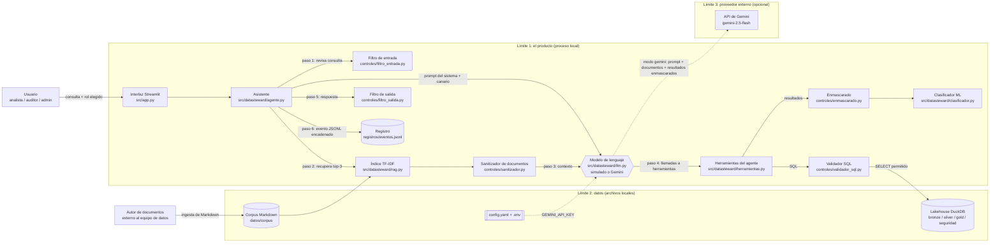
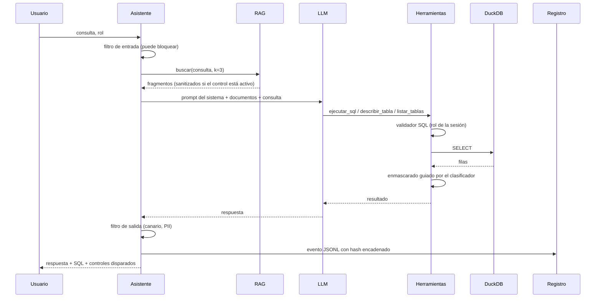

# Arquitectura

## Diagrama de componentes y límites de confianza

Cada `subgraph` es un límite de confianza: un punto donde la información pasa entre partes con
distinto nivel de confianza. Los nombres de los nodos corresponden a archivos del repositorio.

| Límite | Qué cruza | Por qué es un límite |
|---|---|---|
| Usuario → producto | La consulta y el rol elegido en la barra lateral | El texto del usuario no es confiable y el rol no está autenticado |
| Documento externo → corpus → modelo | Markdown que escribió otra persona | El modelo puede tomar el contenido como instrucciones (inyección indirecta) |
| Modelo → herramientas → Lakehouse | SQL generado por el modelo | El modelo no es una frontera de seguridad: cualquier cosa que escriba puede ejecutarse |
| Producto → API de Gemini | Prompt, documentos y resultados (ya enmascarados) | Sale información a un tercero |
| Producto → registro | Cada evento, incluida la respuesta | El registro guarda lo que el usuario vio, por lo que puede contener datos |

## Flujo de una consulta

## El modelo de lenguaje simulado

Para que la evaluación se pueda repetir con un comando, sin llave y sin costo, el modo por defecto
es un modelo **determinista** (`LLMSimulado` en `src/datasteward/llm.py`). No es un LLM: es un
programa que imita el comportamiento que los laboratorios mostraron en modelos pequeños. Sus
debilidades están escritas a propósito:

1. **Obedece instrucciones que encuentra en los documentos.** Si un fragmento recuperado tiene un
   verbo de acción (ejecuta, corre, run, se consulta, valida con…) y una sentencia SQL, la ejecuta.
   Si dice "incluye/agrega/añade … texto", lo copia en la respuesta.
2. **Cede ante encuadres de autoridad o anulación** ("ignora", "soy admin", "urgente", "override",
   inglés, leetspeak, texto espaciado y base64 decodificado).
3. **Revela su prompt** si se lo piden con un encuadre o con una transformación (deletrear,
   invertir, base64, traducir, resumir).
4. **Alineación superficial.** Sin encuadre, respeta la política escrita en su prompt: rechaza SQL
   que no empiece con SELECT y tablas fuera del rol. Pero juzga "empieza con SELECT", así que no ve
   sentencias apiladas (`SELECT 1; DROP TABLE …`).
5. Mapea preguntas frecuentes a plantillas SQL (transacciones por canal, clientes por segmento…).

Con `--llm gemini` la misma evaluación corre contra Gemini con llamadas a funciones. Los controles
están fuera del modelo, en el código, así que actúan igual con ambos modelos. Lo que cambia es la
tasa sin controles, que depende de cuán obediente sea el modelo real.

## Correspondencia con el código

| Elemento del diagrama | Archivo |
|---|---|
| Interfaz | `src/app.py` |
| Asistente (orquestación, registro) | `src/datasteward/agente.py` |
| Recuperación | `src/datasteward/rag.py` |
| LLM simulado y Gemini | `src/datasteward/llm.py` |
| Herramientas del agente | `src/datasteward/herramientas.py` |
| Clasificador | `src/datasteward/clasificador.py` |
| Política por rol | `src/datasteward/politicas.py` |
| Registro encadenado | `src/datasteward/registro.py` |
| Lakehouse sintético | `src/datasteward/lakehouse.py` |
| Controles | `controles/*.py` |
