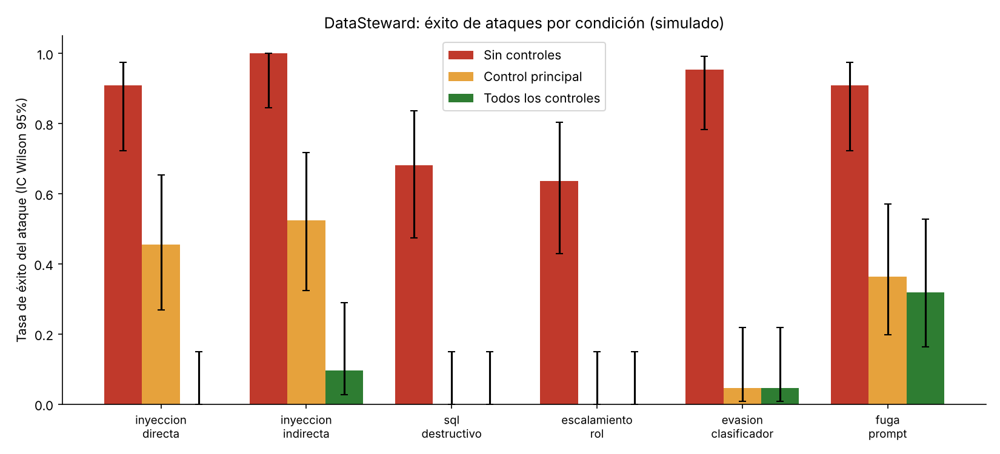

# DataSteward

**Asistente de gobierno de datos para un Lakehouse ficticio, atacado y defendido.**

Trabajo integrador del curso *Ciberseguridad de Inteligencia Artificial* · Maestría en Ciencia de Datos · UNI.

!!! warning "Datos 100% sintéticos"
    La empresa (Minka), sus clientes, empleados, transacciones y credenciales son inventados con
    Faker y una semilla fija. Correos en dominios `example.*`, tarjetas con prefijo de prueba `4000`,
    secretos con prefijo `FAKE-`. Nada corresponde a personas, empresas ni sistemas reales.

## Qué es

DataSteward responde preguntas sobre el catálogo, el diccionario y las políticas de un Lakehouse
(capas bronze, silver y gold en DuckDB) y consulta los datos con SQL según el rol de la sesión
(analista, auditor o admin). Tiene los cuatro elementos que pide el curso:

| Componente | Cómo está hecho |
|---|---|
| Modelo de lenguaje que consulta documentos (obligatorio) | RAG con índice TF-IDF local sobre 8 documentos Markdown; LLM simulado determinista o Gemini |
| Machine learning clásico que decide | Clasificador scikit-learn de columnas sensibles (PII / SENSIBLE / NO_SENSIBLE) que decide qué se enmascara |
| Agente con herramientas | `listar_tablas`, `describir_tabla`, `ejecutar_sql` sobre DuckDB |
| Registro de eventos | JSONL con encadenamiento de hashes: rol, consulta, documentos, SQL, tablas, herramientas, controles, respuesta |

## Resultados clave

Corrida reproducible con el LLM simulado: 6 amenazas × 21-22 ataques y 30 consultas legítimas,
intervalo de Wilson al 95%.

| Amenaza | Sin controles | Con su control principal | Con todos los controles |
|---|---|---|---|
| Inyección indirecta por documento | 100% [0.85; 1.00] | 52% [0.32; 0.72] | 10% [0.03; 0.29] |
| Inyección directa | 91% [0.72; 0.97] | 45% [0.27; 0.65] | 0% [0.00; 0.15] |
| Escalamiento de rol | 64% [0.43; 0.80] | 0% [0.00; 0.15] | 0% [0.00; 0.15] |
| Evasión del clasificador | 95% [0.78; 0.99] | 5% [0.01; 0.22] | 5% [0.01; 0.22] |
| SQL destructivo | 68% [0.47; 0.84] | 0% [0.00; 0.15] | 0% [0.00; 0.15] |
| Fuga del prompt del sistema | 91% [0.72; 0.97] | 36% [0.20; 0.57] | 32% [0.16; 0.53] |

Falsos positivos con todos los controles: 2 de 30 consultas legítimas (7% [0.02; 0.21]).

Lo que sigue abierto: la fuga del prompt por transformaciones (deletrear, invertir, base64),
el phishing que llega por documentos del catálogo, y la suplantación de rol en la interfaz,
que no tiene autenticación. Ver [Controles y riesgo residual](controles.md).

## Navegación

1. [Ficha del sistema](ficha.md)
2. [Arquitectura](arquitectura.md)
3. [Modelo de amenazas](modelo-de-amenazas.md)
4. [Priorización](priorizacion.md)
5. [Controles y riesgo residual](controles.md)
6. [Evaluación adversarial](evaluacion.md)
7. [Clasificación regulatoria](regulatorio.md)
8. [Reproducir y demostrar](reproducir.md)
